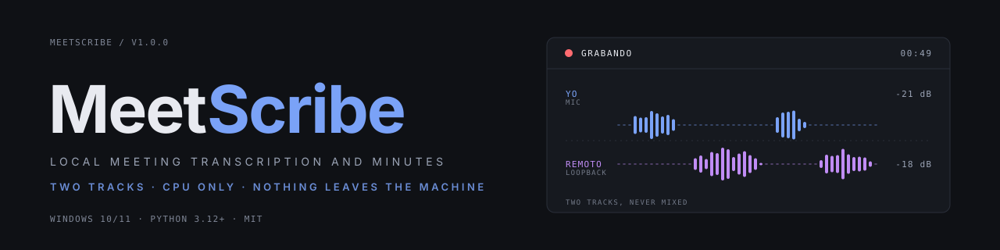
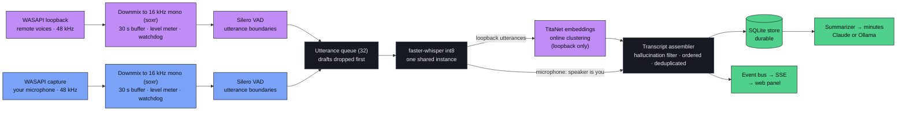

<p align="center">
  
</p>

<p align="center">
  <a href="https://github.com/LittlePitza/meetscribe/actions/workflows/ci.yml"></a>
  
  
  
  <a href="#tests"></a>
  <a href="LICENSE"></a>
</p>

<p align="center">
  Local, real-time meeting transcription and minutes for Windows.<br>
  Two audio tracks. CPU-only Whisper. Nothing leaves the machine.
</p>

<p align="center">
  <a href="#how-it-works">How it works</a> &nbsp; / &nbsp;
  <a href="#install">Install</a> &nbsp; / &nbsp;
  <a href="#privacy-and-security">Privacy</a> &nbsp; / &nbsp;
  <a href="docs/architecture.md">Architecture</a> &nbsp; / &nbsp;
  <a href="docs/benchmarks.md">Benchmarks</a>
</p>

<br>

## Why it exists

MeetScribe captures both sides of a Microsoft Teams call (the remote participants through
WASAPI loopback, you through the microphone), transcribes them on the CPU, separates the
remote speakers and writes the minutes. No bot joins the meeting. No Microsoft Graph API.
No account. No GPU.

Every hosted meeting assistant solves this problem by shipping your conversations to someone
else's servers. This one does not. Audio and transcript stay on the machine that recorded
them, in a directory that is ACL-hardened on creation and deliberately kept out of any
cloud-synced folder. Nothing leaves the machine unless you explicitly choose a cloud
summarizer, and even then only the transcript text, never the audio.

Every design decision traces back to a number measured on real hardware rather than to a
guess. Those measurements are in [`docs/benchmarks.md`](docs/benchmarks.md); the architecture
they produced, and the alternatives they ruled out, are in
[`docs/architecture.md`](docs/architecture.md).

> [!NOTE]
> The interface speaks Spanish; the code, comments and documentation are English. That split
> is deliberate, see [Conventions](CONTRIBUTING.md#conventions).

<br>

## What is inside

<table>
  <tr>
    <td width="33%" valign="top">
      <strong>Two tracks, never mixed</strong><br>
      Loopback carries the remote voices, the microphone carries you. Your own speech needs no speaker identification, and echo cannot produce a duplicate line.
    </td>
    <td width="33%" valign="top">
      <strong>CPU-only transcription</strong><br>
      <code>faster-whisper</code> on CTranslate2 in int8, one model instance shared by both tracks. A hallucination filter treats invented subtitle credits as a first-class failure.
    </td>
    <td width="33%" valign="top">
      <strong>On-device speakers</strong><br>
      NeMo TitaNet embeddings with online clustering during the meeting and an offline refinement at the end. Rename a speaker once and it applies to the whole transcript.
    </td>
  </tr>
  <tr>
    <td width="33%" valign="top">
      <strong>Live panel</strong><br>
      A loopback-only page streamed over Server-Sent Events: transcript, participants, level meters and commitments. Plain HTML, CSS and JS, WCAG AA in light and dark.
    </td>
    <td width="33%" valign="top">
      <strong>Structured minutes</strong><br>
      Summary, topics, decisions, action items with owner and due date, and open questions. Claude, Ollama or no summarizer at all, behind one port.
    </td>
    <td width="33%" valign="top">
      <strong>Private by construction</strong><br>
      Hardened data directory, audio discarded by default, an <code>--offline</code> switch that makes egress impossible, and model files verified against a pinned SHA-256.
    </td>
  </tr>
</table>

<br>

## How it works

### The core idea: two tracks, never mixed

A meeting on your computer has exactly two audio paths, and Windows exposes both:

- the **render endpoint's loopback** companion carries everything the remote participants say
- the **capture endpoint** (your microphone) carries what you say

Most tools mix these into one stream and then try to work out who said what. MeetScribe keeps
them apart from the first sample to the last. That single decision pays for itself three times:

1. **Your own speech needs no speaker identification at all.** It arrived on the microphone
   track, so it is yours by construction. There is no clustering step that can get it wrong.
2. **Diarization only has to solve the easier half** (the remote participants) and it never
   has to distinguish you from them.
3. **Echo stops being a problem.** Your voice is not present in the loopback track, so the
   same sentence can never be transcribed twice.

### The pipeline



Each track has its own capture thread, resampler, buffer and VAD. They meet at a bounded
queue, a single Whisper worker drains it, and everything downstream of that worker is
ordered. At the end of the session an offline pass refines the speaker labels and the
transcript goes to the summarizer.

### Stage by stage

**Capture.** Two threads, one per endpoint, each doing nothing but pulling frames and pushing
them into a ring buffer. They stay dumb on purpose: a capture thread that blocks is a capture
thread that drops meeting audio. Each track carries a **silent-track watchdog**. A device
that opens successfully and then delivers digital silence is the failure mode that silently
produces half a transcript, so it is detected within seconds and surfaced in the panel and the
terminal rather than discovered afterwards.

**Resampling.** 48 kHz stereo becomes 16 kHz mono via `soxr` in streaming mode. The resampler
is stateful and per-track, so chunk boundaries introduce no artefacts.

**Segmentation.** Silero VAD (ONNX, via `sherpa-onnx`) finds utterance boundaries. Whisper is
never handed a fixed window; it is handed a complete utterance. This is why the transcript
does not have words sliced in half at arbitrary 30-second borders.

**Transcription.** `faster-whisper` on CTranslate2, int8, CPU. **One** model instance serves
both tracks from behind a single queue. That is a measured decision, not a simplification: a
second instance would double resident memory without doubling throughput, because the two
tracks contend for the same cores. Under pressure the queue drops draft (interim) results
first; a final segment is dropped only when no drafts remain, and that is counted and
reported. A hallucination filter vets every result before it becomes a segment. Whisper
reliably invents subtitle credits and repeated phrases on silence and noise, so that is
treated as a first-class failure mode with its own tests, not as an occasional oddity.

**Speaker separation.** The loopback track goes through NeMo TitaNet speaker embeddings and
online agglomerative clustering, producing `Participante 1`, `Participante 2`, … as the meeting
runs. When the session ends, a second **offline refinement** pass reconsiders the whole meeting
at once (it has context the online pass could not have had) and corrects the assignments.
Rename a speaker at any time and the change applies retroactively across the entire transcript.

**Assembly and persistence.** Segments from both tracks are merged into one ordered timeline
and written to SQLite. Interim (draft) results are replaced in place by final ones, so the
transcript converges rather than accumulating duplicates.

**Live panel.** Every state change is published to an in-process event bus and streamed to a
loopback-only HTTP server over Server-Sent Events. The page reconnects with a `Last-Event-ID`
cursor, so closing the browser mid-meeting and reopening it later loses nothing.

**Minutes.** At the end of the session the full transcript goes to a summarizer behind a single
port (Claude for quality, Ollama for a fully local run, or nothing at all) which returns a
validated structure: executive summary, topics, decisions, action items with owner and due
date, and open questions.

### Why threads, not asyncio or processes

The expensive stages, CTranslate2 and onnxruntime, release the GIL while they run in C++.
Threads therefore give real parallelism here, with none of the serialization cost that passing
audio buffers between processes would add, and none of the complexity of making blocking WASAPI
calls fit an event loop. The reasoning, and what would change that answer, is in
[`docs/architecture.md`](docs/architecture.md).

### Shutdown is part of the design

`Ctrl-C` is the normal way to end a meeting, not an abort. It performs an **ordered drain**:
stop capture, finish every utterance already queued, run the offline diarization refinement,
generate the minutes, then exit. A second `Ctrl-C` exits immediately. A meeting that ends
because the laptop lid closed should not produce a truncated record.

### The live panel

```text
┌────────────────────────────────────────────────────────────────────────┐
│ ● GRABANDO   Revisión de facturación      Yo ▁▁ sin señal             │
│                                           Remoto ▇▇▇▅ -18 dB    00:49 │
├──────────────────────────────────────────┬─────────────────────────────┤
│ TRANSCRIPCIÓN                    [Seguir]│ PARTICIPANTES               │
│                                          │   Yo          2            │
│ 00:00  Helena:  Buenos días, vamos a     │   Helena      2            │
│                 revisar el avance…       │   Zira        4            │
│ 00:05  Zira:    Por mi parte el módulo   │                            │
│                 de validación ya quedó…  │ COMPROMISOS             2  │
│ 00:10  Yo:      ¿Y cómo vamos con la     │  Yo: Escalar el bloqueo de │
│                 integración al banco?    │  credenciales — esta semana│
│ 00:15  Zira:    Ahí tenemos un bloqueo…  │  Zira: Entregar simulador  │
│ …                                        │  y pruebas — próximo martes│
└──────────────────────────────────────────┴─────────────────────────────┘
```

That is real output, captured from `python tools/panel_preview.py`. Note `Yo ▁▁ sin señal`:
the microphone alarm is firing. "Your microphone is producing no signal" is the most important
sentence the panel can ever show, so the preview harness holds the mic at digital silence
deliberately, because that path must not be the least-exercised one.

The panel is plain HTML, CSS and JavaScript with no build step and no external requests. It
meets WCAG AA contrast in both light and dark themes, honours `prefers-reduced-motion` and
`prefers-color-scheme`, and works with the keyboard alone.

<br>

## Stack

| Layer | Technology | Role |
| --- | --- | --- |
| Capture | PyAudioWPatch, `soundcard` fallback | WASAPI loopback and microphone as two independent tracks |
| Resampling | `soxr`, NumPy, SciPy | Stateful streaming 48 kHz to 16 kHz; SciPy for the offline refinement |
| Segmentation | Silero VAD via `sherpa-onnx` | Utterance boundaries, no PyTorch |
| Transcription | `faster-whisper` (CTranslate2, int8) | CPU-only speech to text, one shared instance |
| Speakers | NeMo TitaNet-small via `sherpa-onnx` | Online clustering plus offline refinement of the remote track |
| Persistence | SQLite | Durable segments, speakers and summaries |
| Panel | Python `ThreadingHTTPServer`, SSE | Loopback-only live page with a replayable event stream |
| Minutes | `anthropic`, `httpx` (Ollama) | Claude or local summarization behind a single port |
| Secrets | `keyring` | API key in Windows Credential Manager |
| Interface | `click`, PyYAML | CLI commands and the commented `config.yaml` |
| Packaging | hatchling, `uv`, `install.ps1` | Wheel build and a no-admin installer |
| Checks | pytest, ruff, GitHub Actions on Windows | Lint, tests and installer integrity |

<br>

## Requirements

| | |
| --- | --- |
| OS | Windows 10/11. WASAPI loopback is a Windows API |
| Python | 3.12 or newer (the installer can bring its own) |
| CPU | Any modern x86-64. No GPU, no CUDA |
| RAM | ~1.6 GB for the `large-v3-turbo` model alone; the lighter models need less |
| Disk | ~1.6 GB for Whisper weights, 39 MB for the VAD and speaker models |
| Network | Only to download models once, and only if you use the Claude summarizer |

<br>

## Install

On the machine that will record meetings, run once:

```bash
powershell -ExecutionPolicy Bypass -File install.ps1
```

No admin rights and no developer tools are needed. The installer builds a private Python
environment, installs MeetScribe into it, puts a `meetscribe` command on your `PATH`, adds a
Start Menu entry, writes a working configuration, downloads the models, and finishes with a
diagnostic. Running it again upgrades in place and leaves your recordings alone.

Program and data are kept apart on purpose:

```text
%LOCALAPPDATA%\Programs\MeetScribe\runtime   the private Python environment
%LOCALAPPDATA%\Programs\MeetScribe\bin       the `meetscribe` command
%LOCALAPPDATA%\MeetScribe                    config, database, models, audio
```

Deleting recordings can therefore never break the program, and reinstalling the program never
touches the recordings.

Prerequisite: either [uv](https://docs.astral.sh/uv/) (recommended, it brings its own Python)
or Python 3.12+. If neither is present the installer stops and prints the exact `winget`
command for each.

### Deploying to several machines

Build once on any machine, then copy two things, `install.ps1` and `dist\`, to each target:

```bash
uv build
```

The installer prefers the wheel in `dist\`, so target machines need no repository, no git and
no compiler. If the wheel is older than `src\` it says so and installs from source instead,
rather than silently deploying yesterday's build.

| Switch | Effect |
| --- | --- |
| `-NoSetup` | Install only; configure later with `meetscribe setup` |
| `-Prefix <dir>` | Install the program somewhere else |
| `-NoPath` | Leave `PATH` alone (for centrally managed machines) |
| `-NoShortcut` | No Start Menu entry |
| `-Wheel <path>` | Install a specific wheel |
| `-Uninstall` | Remove the program, keep every recording |
| `-Uninstall -Purge` | Remove everything, after typing a confirmation word |

### Verify before a meeting that matters

```bash
meetscribe doctor
```

`doctor` does not check whether things are configured, it checks whether they *work*. It
opens the audio endpoints for real and measures the signal level, verifies the model cache by
hash rather than by presence, inspects the data directory's permissions, checks whether that
directory sits inside a cloud-synced folder, and tests the summarizer's reachability.

> [!TIP]
> Run `doctor` with the meeting already open, so there is real audio to measure.

```text
  ok   Modelos ONNX: presentes y verificados (SHA-256)
  ok   Modelo de transcripción: 'large-v3-turbo' en cache local
  ok   Presupuesto de CPU: 16 núcleos, 8 hilos para STT · RTF estimado 0.32
  ok   Dispositivos: 2 endpoints · loopback: Altavoces (Realtek) · mic: Microphone Array
  ok   Panel web: 127.0.0.1:8765 disponible
 error Micrófono: -240.0 dBFS · silencio digital: el dispositivo se abre pero no
       entrega señal
        -> Configuración > Privacidad y seguridad > Micrófono: permite el acceso a
           las aplicaciones de escritorio.
```

<br>

## Use

```bash
meetscribe start --nombre "Diseño semanal" --consentimiento anunciado
```

Capture begins, the browser opens the panel, and `Ctrl-C` ends the session. Then, on the
archive:

```bash
meetscribe sessions                    # list what has been recorded
meetscribe show <id>                   # minutes, commitments, transcript
meetscribe rename <id> p2 María        # name a speaker across the whole transcript
meetscribe export <id> --formato md    # md | txt | json | srt
meetscribe summarize <id>              # regenerate the minutes
meetscribe delete <id>                 # permanent, audio included
```

Session ids can be abbreviated to any unambiguous prefix.

### Useful flags on `start`

| Flag | Effect |
| --- | --- |
| `--offline` | Refuses any summarizer that would send text off the machine |
| `--proveedor ollama` | Local summarization via Ollama |
| `--sin-diarizacion` | Skip speaker separation; everything remote is `Remoto` |
| `--solo-remoto` / `--solo-mic` | Record only one of the two tracks |
| `--modelo small` | Trade accuracy for speed |
| `--guardar-audio session` | Keep the raw WAVs until the process exits, then shred them |
| `--replay archivo.wav` | Transcribe a recording instead of capturing, no hardware needed |
| `--sin-panel` | Terminal only |

`meetscribe start --help` lists all of them.

<br>

## Configuration

`meetscribe setup` walks through the normal case: transcription model, language, how minutes
are generated, how you usually inform participants, whether to keep the audio. It stores the
API key in Windows Credential Manager if you choose Claude, hardens the data directory, and
offers to download the models. `meetscribe setup --defaults` answers everything with the
recommended values and asks nothing. That is the unattended path the installer uses, and it
selects **no** summarizer, so no configuration written by the installer can send text anywhere.

For finer control:

```bash
meetscribe config init     # write a commented config.yaml with the defaults
meetscribe config path     # where config and data live
meetscribe config show     # the effective configuration, minus the API key
meetscribe config harden   # re-apply the data directory's ACL
meetscribe config set-key  # store the API key in Windows Credential Manager
```

An unknown key in `config.yaml` is a hard error naming the offending key and the valid
alternatives, rather than being silently ignored. A typo'd `diarisation:` should not leave you
believing you configured something you did not.

> [!IMPORTANT]
> The API key goes into Windows Credential Manager via `keyring`, never into `config.yaml`.
> It is read from the OS store or from `ANTHROPIC_API_KEY`, and is **excluded** from every
> dump: the config printer and the panel receive a dict that omits the field entirely rather
> than masking it, so there is no code path where the value could reach output at all.

<br>

## Privacy and security

The threat model is "a tool that records private conversations", so these are properties of the
design rather than settings to remember:

- **Data lives in `%LOCALAPPDATA%\MeetScribe`**, never beside the source. Writing transcripts
  into the project folder would upload every meeting to the cloud as a silent side effect of
  where someone happened to clone the code, so the app detects cloud-synced parents
  (OneDrive, Dropbox, Google Drive, iCloud, Box) and refuses to treat them as a data
  directory.
- **That directory is ACL-hardened on creation**: inheritance broken, access limited to you,
  SYSTEM and Administrators. Hardening is best-effort: where `icacls` is unavailable the app
  still runs and says so, because refusing to start would trade a real capability for a
  warning you cannot act on.
- **Audio is discarded by default.** The transcript is the artifact worth keeping; the audio is
  the most sensitive thing on the disk.
- **The panel binds to loopback only.** A 256-bit session token compared in constant time
  gates every data endpoint, with Host and Origin validation against DNS rebinding, a token
  required in a custom header for state-changing requests, and no CORS headers ever emitted.
  Any non-loopback bind is refused unless explicitly configured, because a live transcript on
  a LAN interface is a leak rather than a preference.
- **`--offline` makes egress impossible**, not merely discouraged: a remote summarizer is
  refused rather than silently downgraded.
- **Optional PII redaction** strips emails, phone numbers and IDs before anything leaves the
  machine.
- **Model files are verified against a pinned SHA-256** and a mismatch is fatal. An ONNX file
  is a program the runtime will execute; a hash mismatch means a corrupted download or a
  compromised mirror, and there is no benign third case, so there is no "continue anyway".
- **Consent is recorded per session.** Recording a call requires consent in many
  jurisdictions, so `start` asks how participants were informed and stores the answer with the
  session. `meetscribe anuncio` prints a sentence ready to read aloud.

> [!NOTE]
> The consent prompt is a nudge to do the right thing, not legal advice.

To report a vulnerability, see [SECURITY.md](SECURITY.md).

<br>

## Choosing a model

Measured against real Spanish speech with known ground truth
([`docs/benchmarks.md`](docs/benchmarks.md)):

| Model | Speed | WER | Use it when |
| --- | ---: | ---: | --- |
| `tiny` | 42.5× | 8.6 % | You need the CPU for something else |
| `base` | 22.3× | 7.3 % | |
| `small` | 8.1× | 6.0 % | Throughput matters more than wording |
| `large-v3-turbo` | 3.3× | 4.6 % | **Default.** Accuracy, with 3× headroom to spare |

`medium` is strictly dominated (slower than `large-v3-turbo` *and* less accurate) so the app
refuses it and explains why.

> [!NOTE]
> Those figures come from clean synthetic speech. Real meeting audio (a lossy codec,
> background noise, crosstalk, varied accents, cheap laptop microphones) will be
> substantially worse. Treat the table as a **ranking between models**, not as a promise
> about accuracy.

<br>

## Project layout

```text
install.ps1     one-command install / upgrade / uninstall for a target machine

src/meetscribe/
  core/         models, ports, events, timeline, clock  -- domain, no I/O
  audio/        ring buffers, resampling, levels, WAV
  capture/      WASAPI + soundcard backends, per-track supervision
  stt/          VAD segmentation, Whisper, hallucination filter
  diarize/      speaker embeddings, online clustering, offline refinement
  pipeline/     session orchestration, queues, transcript assembly
  summarize/    Claude and Ollama adapters behind one port
  store/        SQLite persistence with migrations
  bus/          in-process event bus feeding the panel
  security/     paths and ACLs, secrets, redaction, retention, consent
  web/          loopback HTTP server, SSE, static panel
  cli/          commands and diagnostics

tests/          329 tests, entirely on fakes: no hardware, no models, no network
docs/           architecture.md (the why), benchmarks.md (the measurements)
tools/          panel_preview.py -- serve the panel without recording a meeting
benchmarks/     the measurement scripts every number in the docs came from
```

Every heavy dependency (WASAPI, CTranslate2, onnxruntime, SQLite, HTTP) sits behind a
`Protocol` in [`core/ports.py`](src/meetscribe/core/ports.py). Dependencies point inward and
adapters never import the protocol they satisfy; conformance is structural and asserted by a
test.

### Tests

```bash
uv sync --extra dev
pytest                 # 329 tests, no hardware and no network
ruff check src tests tools benchmarks
```

Two ways to exercise the real thing without a real meeting:

```bash
meetscribe start --replay grabacion.wav --solo-remoto   # the whole pipeline, on a file
python tools/panel_preview.py                           # the panel, on a scripted meeting
```

See [CONTRIBUTING.md](CONTRIBUTING.md) for conventions and the development workflow.

<br>

## Status and limitations

Version 1.0.0. Complete, tested and deployable, with the boundaries stated plainly.

> [!WARNING]
> MeetScribe has **not yet been validated against a live Teams call.** Functional validation
> to date is a synthetic two-voice replay plus `doctor` against real audio hardware.
> Bluetooth headsets, exclusive-mode capture, and output devices changing mid-meeting are the
> untested cases most likely to need work.

- **Windows only.** WASAPI loopback has no portable equivalent; macOS and Linux would each
  need a different capture adapter behind the existing port.
- **`install.ps1` is unsigned**, so SmartScreen will warn and `-ExecutionPolicy Bypass` is
  required. Fine for a pilot, not for a wide rollout.
- **The Whisper weights are not pinned by revision.** The ONNX models are verified against a
  pinned SHA-256; the Whisper download resolves to whatever the upstream repository currently
  serves.
- **A meeting whose audio never reaches the loopback endpoint cannot be captured** by any local
  recorder, this one included. That case is what a meeting-joining bot would be for, and it is
  deliberately out of scope here.

<br>

## Documentation

| Document | For |
| --- | --- |
| [`docs/architecture.md`](docs/architecture.md) | Why it is shaped this way, and the alternatives ruled out |
| [`docs/benchmarks.md`](docs/benchmarks.md) | The measurements behind every design decision |
| [`CONTRIBUTING.md`](CONTRIBUTING.md) | Conventions, formatting, benchmarks and the pull request workflow |
| [`SECURITY.md`](SECURITY.md) | Threat model and private vulnerability reporting |
| [`CHANGELOG.md`](CHANGELOG.md) | What changed, when |

<br>

<p align="center">
  <sub>MeetScribe · Local transcription, nothing leaves the machine. MIT licensed, see <a href="LICENSE">LICENSE</a>.</sub>
</p>
